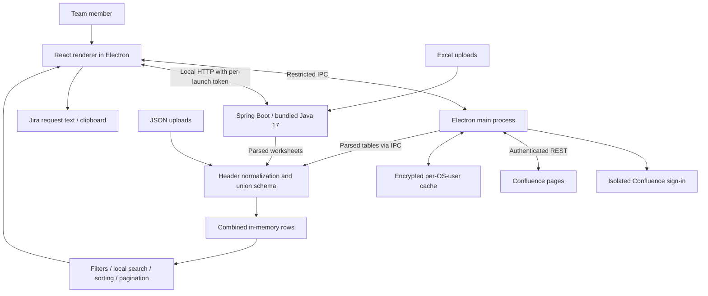

# Architecture and high-level design

One Data combines Confluence and local files into a desktop test-data workspace. Each installation has its own snapshot. There is no central One Data database, shared request-status service or required hosted frontend.

## Components

- **Electron/Node.js:** starts/stops Java, opens the UI, restricts navigation/permissions and owns Confluence access. The renderer is sandboxed with context isolation and no Node integration. The preload bridge exposes named operations only.
- **React 18/TypeScript/Vite/CSS:** source management, JSON parsing, schema merging, filters/search, presentation and request drafting.
- **Java 17/Spring Boot 3.2/Apache POI:** serves the built frontend in desktop mode and parses Excel. H2/JPA supports the original sample directory, not the combined multi-source data.
- **Confluence hub and parse5:** coordinate independent page states and convert HTML tables into text without injecting remote HTML.
- **Maven/jlink/electron-builder:** build the JAR, trim/package Java and produce platform packages.

## Lifecycle and storage

1. Electron starts Java on `127.0.0.1` with port `0` (OS-assigned port), waits for readiness, and loads the local UI. A random per-launch token protects desktop HTTP endpoints.
2. Manual mode opens the workspace after the splash. Each teammate signs into Confluence through a separate sandboxed window and in-memory authentication session. No login credentials are bundled.
3. Authenticated read-only REST fetches the current user and page body/version. Page URLs are restricted to the configured organization origin; IPC caller/frame identity is validated.
4. The hub refreshes every five minutes after sign-in. Network/parse failures keep each page's last good copy; confirmed access denial clears that page. Account changes clear the previous owner's copies. Sign-out clears downloaded copies and login state, retaining page links.
5. `safeStorage` encrypts configuration and saved rows under the OS user's app profile. Offline access relies on that OS account; it does not re-prove current Confluence authorization.
6. Uploaded JSON/Excel data is session-only. Theme and selected filter-column names are remembered locally. Search text is not sent to an AI provider.

## Schema and filtering

Rows carry column metadata (`key`, displayed `label`, sensitive flag). Header normalization ignores case/spacing/punctuation and recognizes known aliases such as MSISDN/Username, Country/Market, Service/Service type and Pass/Password. Unknown headers remain columns, with the first encountered label displayed. The union fills absent/empty values with `null`, preserves zero/false/textual leading zeroes, appends rows without deduplication and adds Source attribution.

Users choose filter columns from that union. Small value lists use buttons; identifiers, sensitive columns and lists over 30 values use text inputs. See [sample formats and limits](../samples/README.md).

## Interfaces

| Interface | Responsibility |
| --- | --- |
| `GET /api/users`, `GET /api/users/stats` | Original sample directory/counts |
| `POST /api/users/import-tables` | Multipart Excel to `{name, records}` worksheet array; no persistence |
| `POST /api/users/import` | Legacy fixed-schema workbook import |
| `confluence:state`, `add-page`, `remove-page`, `refresh` | Validated desktop source operations |
| `confluence:sign-in`, `sign-out`, `use-offline` | Authentication/cache lifecycle |
| `confluence:changed` | State updates to the renderer |

## Boundaries and future extensions

- Smart Search is local and deterministic. A future approved LLM adapter should return validated search conditions for local execution; no LLM is connected now.
- Jira currently produces copyable content only. Direct creation needs separate authenticated integration and a deliberate submission step.
- Token generation is hidden and its endpoint is a demo stub, not the Appium framework.
- Password columns are intentionally visible; other sensitive columns are masked. Do not put live data into code, fixtures or logs.
- Windows x64 has been tested. macOS builds are configured but need platform/SSO validation. Packages are not a signed/notarized production deployment.
